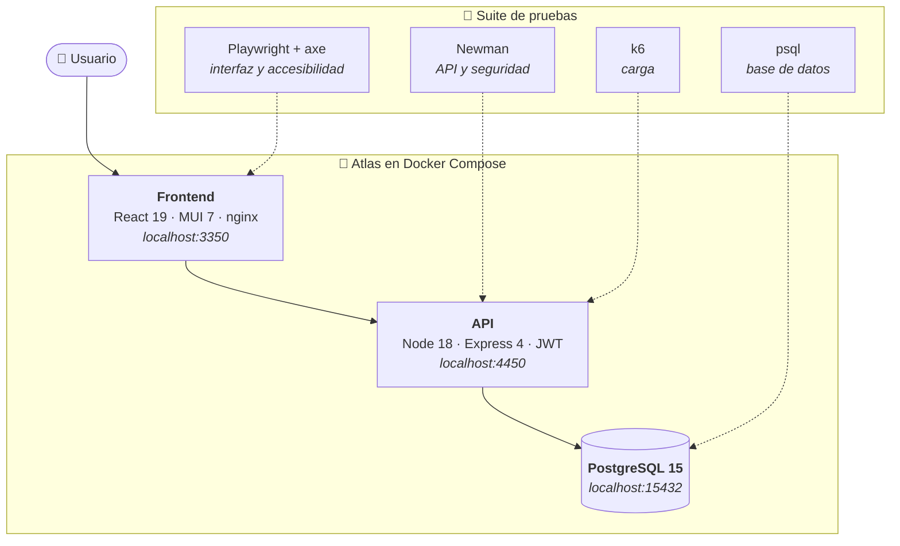

<div align="center">


# Atlas · Verificación de seguridad y calidad

**Suite de pruebas automatizadas para Atlas, la plataforma de CreaLab SpA con la que distintas pymes gestionan sus clientes, contratos y documentos en un mismo sistema.**

<br>


<br>


[Inicio rápido](#-inicio-rápido) · [Resultados](#-resultados) · [Evidencias](#-evidencias) · [Estructura](#-estructura-del-repositorio) · [Hoja de ruta](#-hoja-de-ruta)

</div>

---

## 📌 Resumen

Atlas guarda en una misma base de datos la información de varias empresas, incluidos RUT y cuentas bancarias de sus clientes. Cada empresa debe ver solo lo suyo, y por eso esta suite pone el foco en el control de acceso, la protección de datos personales, el rendimiento y la accesibilidad para adultos mayores.

Las pruebas se ejecutan sobre el **código oficial de Atlas desplegado con Docker, sin modificarlo**. Cada falla queda registrada como hallazgo, con su evidencia y su propuesta de corrección.

> [!IMPORTANT]
> **Dictamen de la última verificación: no apto para producción.**
> Hay tres problemas críticos abiertos: el servidor no valida los permisos de cada rol, una empresa puede leer datos de otra cambiando un identificador y las contraseñas se guardan sin cifrar. Hasta corregirlos, el sistema expone datos protegidos por la Ley 19.628 y la Ley 21.719.

---

## 🧭 Qué se verifica

| Área | Qué se comprueba | Herramienta |
|---|---|---|
| 🔐 **Acceso y sesión** | Inicio de sesión, bloqueo tras intentos fallidos, política de contraseñas, permisos por rol | Postman · Newman |
| 🏢 **Aislamiento entre empresas** | Que una empresa no pueda leer ni modificar datos de otra | Postman · Newman |
| 🛡️ **Ataques comunes** | Inyección SQL y scripts maliciosos guardados en formularios | Postman · Newman |
| 🗄️ **Protección de contraseñas** | Que se almacenen con hash seguro (bcrypt) | Consulta directa a PostgreSQL |
| 📦 **Dependencias y código** | Librerías con vulnerabilidades conocidas y errores de calidad | npm audit · ESLint |
| ⚡ **Rendimiento** | Tiempo de respuesta bajo carga (meta: menos de 300 ms) | Grafana k6 |
| ♿ **Accesibilidad** | Tamaño de texto, contraste, botones legibles y uso en celular (WCAG 2.1 AA) | Playwright · axe-core |

---

## 🏗️ Arquitectura



| Servicio | Tecnología | Dirección local |
|---|---|---|
| Frontend | React 19, MUI 7, Vite 7 servido por nginx | http://localhost:3350 |
| API | Node 18, Express 4, autenticación con JWT | http://localhost:4450 (documentación en `/docs`) |
| Base de datos | PostgreSQL 15 | `localhost:15432` |

---

## 🚀 Inicio rápido

### Requisitos

- [Docker Desktop](https://www.docker.com/products/docker-desktop/) con Docker Compose
- [Node.js](https://nodejs.org/) 18 o superior
- El código de Atlas en una carpeta hermana llamada `CodigoFuenteETA/`

```
📁 carpeta-de-trabajo/
├── 📁 CodigoFuenteETA/                  ← sistema Atlas (no se modifica)
├── 📁 ISY1102-EP1-Plan-Pruebas-Atlas/   ← este repositorio
└── 📁 evidencias-release/               ← se crea con los resultados
```

### 1. Levantar Atlas

```bash
cd CodigoFuenteETA
docker-compose up -d --build
```

Cuando los tres contenedores estén en ejecución, el frontend responde en http://localhost:3350 y la API en http://localhost:4450/docs.

### 2. Instalar la suite

```bash
cd ../ISY1102-EP1-Plan-Pruebas-Atlas
npm install
npx playwright install chromium
```

### 3. Preparar los datos de prueba

```bash
npm run preparar
```

Este paso crea un usuario exclusivo para probar el bloqueo de cuenta (así la cuenta de administrador nunca se bloquea) y genera un archivo local con las credenciales de prueba. Ese archivo termina en `.local.json` y **nunca se sube al repositorio**.

### 4. Ejecutar las pruebas

| Comando | Qué hace |
|---|---|
| `npm run test:api:docker` | Recorre la API con 48 peticiones y 43 verificaciones: acceso, roles, aislamiento entre empresas, inyección y contratos |
| `npm run test:sast` | Revisa dependencias del backend y del frontend, y la calidad del código |
| `npm run test:a11y` | Mide la accesibilidad en celular (375 px) y escritorio (1440 px) |
| `npm run test:e2e` | Recorre el flujo principal en el navegador |

<details>
<summary><b>Prueba de carga con k6 (sin instalarlo)</b></summary>

<br>

k6 se ejecuta desde su imagen oficial de Docker, dentro de la misma red de Atlas:

```bash
docker run --rm -i --network atlas-network \
  -e BASE_URL=http://atlas-backend:4000 \
  -e ATLAS_USER=admin -e ATLAS_PASS=<contraseña-de-prueba> \
  -e VUS=10 -e SUBIDA=15s -e MESETA=45s -e BAJADA=5s \
  grafana/k6 run - < pruebas/rendimiento/carga_atlas.js
```

`VUS` define cuántos usuarios simultáneos se simulan. Para la prueba completa de 200 usuarios basta con cambiar ese valor.

</details>

### 5. Generar las evidencias

```bash
npm run evidencias                            # despliegue, API, base de datos y rendimiento
node pruebas/reportes/capturas-terminal.js    # salidas de consola del análisis estático y de PostgreSQL
```

Las capturas, los registros y los reportes se guardan en `../evidencias-release/`, fuera del repositorio, para no versionar datos de prueba.

---

## 📊 Resultados

<div align="center">

| ✅ Aprobados | ❌ Con fallas | 🔴 Críticos | 🟠 Graves | ⏳ Pendientes |
|:---:|:---:|:---:|:---:|:---:|
| **7** | **15** | **3** | **5** | **23** |

</div>

### Lo que funciona

Inicio de sesión con token, registro de usuarios y empresas, creación de clientes y contratos, y carga de documentos PDF (54 ms) con recuperación correcta.

### Hallazgos principales

| Severidad | Hallazgo | Impacto |
|:---:|---|---|
| 🔴 Crítico | El servidor no valida permisos por rol: un usuario de solo lectura puede crear, editar y borrar | Cualquier usuario puede alterar datos |
| 🔴 Crítico | Una empresa puede leer contratos, documentos y usuarios de otra cambiando un identificador | Exposición de datos personales de terceros |
| 🔴 Crítico | Las contraseñas se guardan en texto plano (0 de 9 con hash) | Una filtración de la base expone todas las cuentas |
| 🟠 Grave | No hay bloqueo tras 5 intentos fallidos y se aceptan contraseñas como `1234` | Cuentas vulnerables a fuerza bruta |
| 🟠 Grave | El registro de auditoría se puede leer sin iniciar sesión | Exposición de la actividad de todas las empresas |
| 🟠 Grave | 1 vulnerabilidad crítica y 22 altas en librerías; Node 18 sin soporte | Riesgo conocido y explotable |
| 🟠 Grave | Una espera fija de 4 segundos en login y listados: 4004 ms frente a la meta de 300 ms | Experiencia lenta para todos los usuarios |

<details>
<summary><b>Ver hallazgos moderados y leves</b></summary>

<br>

| Severidad | Hallazgo |
|:---:|---|
| 🟡 Moderado | Se guardan scripts en los formularios sin validar (la interfaz los neutraliza, pero quedan almacenados) |
| 🟡 Moderado | El estado de contrato "activo" no existe; solo se calculan "por vencer" y "vencido" |
| 🟡 Moderado | Los inicios de sesión fallidos no quedan auditados |
| 🟡 Moderado | Texto de 10,5 px, contraste insuficiente y 8 botones sin nombre para lectores de pantalla |
| 🟡 Moderado | En celular, el menú lateral deja solo 135 px de ancho para el contenido |
| ⚪ Leve | Los errores del servidor muestran detalles técnicos al usuario |
| ⚪ Leve | Variables sin uso y dependencias incompletas en el código del frontend |

</details>

> [!NOTE]
> **Alcance de esta verificación.** La carga se probó con 10 usuarios simultáneos, suficiente para demostrar que no se cumple la meta de tiempo; la prueba con 200 queda para después de corregir la espera fija. El ambiente local no usa HTTPS, por lo que el cifrado en tránsito no se pudo verificar. Los 23 requerimientos pendientes están identificados en la [matriz de trazabilidad](anexos/matriz-trazabilidad.csv).

---

## 🖼️ Evidencias

Cada captura sale de la ejecución real y se puede rastrear hasta su registro original.

| Captura | Qué muestra | Cómo se obtuvo |
|---|---|---|
| **CAP-01** | Los tres contenedores en ejecución | Docker Desktop |
| **CAP-02** | Pantalla de login y documentación de la API | Navegador automatizado (Playwright) |
| **CAP-03** | Vulnerabilidades en librerías y errores de código | Consola, con la salida resumida en pantalla y el detalle completo en el registro |
| **CAP-04** | Bloqueo de cuenta y política de contraseñas | Newman |
| **CAP-05** | Permisos por rol, aislamiento entre empresas e inyección | Newman |
| **CAP-06** | Contraseñas en la base de datos | Consulta directa, con los valores enmascarados |
| **CAP-07** | Contratos, auditoría y tiempos de respuesta | Newman y k6 |
| **CAP-08** | Accesibilidad para adultos mayores | Playwright y axe-core |

La matriz de trazabilidad conecta cada requerimiento con su caso de prueba, su verificación, su captura y, si falló, su hallazgo.

---

## 📂 Estructura del repositorio

```
📦 ISY1102-EP1-Plan-Pruebas-Atlas
├── 📁 pruebas/
│   ├── 📁 api/            Colección Postman y preparación de datos de prueba
│   ├── 📁 e2e/            Flujo principal, accesibilidad y capturas de despliegue
│   ├── 📁 rendimiento/    Script de carga con perfil configurable
│   ├── 📁 sast/           Revisión de dependencias y calidad del código
│   ├── 📁 reportes/       Generación de evidencias con fecha y hora
│   └── 📁 usabilidad/     Guion para sesiones con usuarios
├── 📁 anexos/             Matriz de trazabilidad y planilla de casos
├── 📁 laboratorio/        Ambiente de pruebas construido en una etapa anterior
├── 📁 docs/               Informes y presentaciones de cada etapa
├── 📁 assets/             Imágenes del repositorio
└── 📁 .github/workflows/  Pipeline de pruebas para GitHub Actions
```

---

## 🗺️ Hoja de ruta

**Corrección, en orden de riesgo**

- [ ] Validar en el servidor el rol y la empresa en cada petición
- [ ] Guardar las contraseñas con bcrypt y migrar las existentes
- [ ] Bloquear la cuenta tras 5 intentos y exigir contraseñas de al menos 12 caracteres
- [ ] Eliminar la espera fija y repetir la carga con 200 usuarios
- [ ] Actualizar librerías y la imagen base de Node
- [ ] Corregir tipografía, contraste, botones y diseño en celular

**Continuidad de la calidad**

- [ ] Ejecutar esta suite en cada pull request desde GitHub Actions
- [ ] Respaldo diario de la base con restauración probada cada mes
- [ ] Monitoreo de disponibilidad con alertas
- [ ] Migraciones de base de datos versionadas

---

## 🧱 Trayectoria del proyecto

| Etapa | Qué se hizo |
|---|---|
| **1 · Plan de pruebas** | Criterios de calidad, estrategia, nueve casos de prueba y matriz de trazabilidad |
| **2 · Laboratorio** | Sin ambiente disponible, se construyó un laboratorio desde la especificación y se ejecutaron los casos. Ahí aparecieron los primeros problemas de aislamiento entre empresas |
| **3 · Defensa** | Presentación de hallazgos y su lectura ética y legal |
| **4 · Código oficial** | La suite se alineó con la API real y se agregaron accesibilidad, análisis de dependencias y evidencias con fecha. El código oficial no implementa varios controles que el laboratorio sí modelaba, y por eso fallan casos que antes pasaban |
| **5 · Cierre del ciclo** | Cifras consolidadas desde la última corrida, capturas reales, informe final y presentación del release |

<details>
<summary><b>Glosario</b></summary>

<br>

| Término | Significado |
|---|---|
| **JWT** | Token firmado que identifica al usuario después de iniciar sesión |
| **RBAC** | Control de acceso según el rol del usuario |
| **IDOR** | Acceder a un recurso ajeno cambiando su identificador en la petición |
| **bcrypt** | Algoritmo para guardar contraseñas de forma irreversible |
| **SAST** | Análisis del código y sus dependencias sin ejecutar la aplicación |
| **DAST** | Pruebas sobre la aplicación en ejecución |
| **p95** | Tiempo de respuesta que cumple el 95 % de las peticiones |
| **WCAG 2.1 AA** | Estándar internacional de accesibilidad web |

</details>

---

<div align="center">

### 👥 Equipo

**Elías Delgado Manríquez** · **Rolando Aldana**

Seguridad y Calidad en el Desarrollo de Software · Duoc UC · Sección 004V<br>
Docente: Johnnathan René Cubillos Flores

</div>
