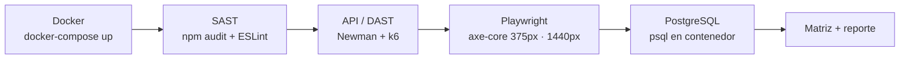

<p align="center">
  
</p>

<h1 align="center">Atlas: verificación de seguridad y calidad</h1>

<p align="center">
  Suite QA del <b>Grupo 15</b> (ISY1102, Duoc UC) para <b>Atlas</b>, la plataforma de CreaLab SpA con la que las pymes gestionan clientes, contratos y documentos.
</p>

## Propósito

Verificar el código oficial de Atlas (Caso A, Docker) contra la ERS: requerimientos funcionales (RF), reglas de negocio (RB) y no funcionales (NFR) de seguridad, rendimiento, accesibilidad y compatibilidad. El marco de referencia es la Ley 19.628 / 21.719 de datos personales, OWASP Top 10 y WCAG 2.1 AA.

## Stack probado

| Capa | Tecnología | Puerto host |
|---|---|---|
| Frontend | React 19 · MUI 7 · Tailwind · Vite 7 · nginx | `3350` |
| Backend | Node 18 · Express 4 · JWT · multer · Swagger (`/docs`) | `4450` |
| Base de datos | PostgreSQL 15 | `15432` |

## Flujo QA



## Estructura

```
pruebas/
  api/           colección Postman (48 requests, IDs de requerimiento en cada aserción) + preparar-datos.js
  e2e/           capturas de despliegue, auditoría de accesibilidad, flujo principal (CP-09)
  rendimiento/   carga_atlas.js (k6, perfil configurable por variables)
  sast/          sast-atlas.js: npm audit backend/frontend + ESLint
  reportes/      renderizado de evidencias (HTML → PNG con marca de tiempo)
  usabilidad/    guion de sesión SUS
anexos/          matriz de trazabilidad (estado, captura, incidente) y planilla de casos
laboratorio/     ambiente QA local usado en EP3
docs/            informes EP1 / EP3 y defensa EP4
```

## Comandos rápidos

```bash
# 1. SUT oficial (carpeta hermana)
cd ../CodigoFuenteETA && docker-compose up -d --build

# 2. Suite
cd ../ISY1102-EP1-Plan-Pruebas-Atlas
npm install && npx playwright install chromium
npm run preparar           # qa_lockout + environment local (*.local.json, fuera de git)
npm run test:api:docker    # RF / RB / NFR-SEG vía Newman
npm run test:sast
npm run test:a11y          # NFR-USAB-1, NFR-COMPAT-2 y CAP-08
npm run evidencias         # CAP-02, CAP-04..CAP-07
node pruebas/reportes/capturas-terminal.js   # CAP-03 y CAP-06 (salida real de consola)

# carga sin k6 local, desde la red de Docker
docker run --rm -i --network atlas-network -e BASE_URL=http://atlas-backend:4000 \
  -e ATLAS_USER=admin -e ATLAS_PASS=... -e VUS=10 -e SUBIDA=15s -e MESETA=45s -e BAJADA=5s \
  grafana/k6 run - < pruebas/rendimiento/carga_atlas.js
```

Las evidencias se escriben en `../evidencias-release/`, fuera del repositorio, para no versionar capturas ni logs con datos de prueba.

## Cobertura y hallazgos (release v2, 2026-11-26)

22 requerimientos ejecutados: **7 PASS · 15 FAIL**. El detalle está en [`anexos/matriz-trazabilidad.csv`](anexos/matriz-trazabilidad.csv).

**Dictamen: no apto para producción.** Quedan abiertos 3 incidentes críticos y 5 graves. Los tres críticos (sin control de roles en el backend, IDOR entre empresas y contraseñas en texto plano) exponen datos personales y bancarios de terceros. Mientras sigan abiertos, CreaLab no puede demostrar las medidas de seguridad que exigen la Ley 19.628 y la Ley 21.719.

| Requerimiento | Estado | Severidad | Hallazgo |
|---|---|---|---|
| RF-3.2 · RB-4 · NFR-SEG-4 | FAIL | Crítico | El backend no aplica roles: el editor crea, edita y elimina |
| RB-2 | FAIL | Crítico | IDOR: contratos, PDF y usuarios de otra empresa accesibles por id |
| NFR-SEG-2 | FAIL | Crítico | Contraseñas en texto plano (0/9 con bcrypt) |
| RF-1.3 | FAIL | Grave | Sin bloqueo tras 5 intentos fallidos |
| R-2.4 | FAIL | Grave | Acepta contraseñas de 4 caracteres |
| SAST-1 | FAIL | Grave | 1 critical y 22 high entre backend y frontend; base Node 18 EOL |
| NFR-PERF-1 | FAIL | Grave | p95 CRUD de 4004 ms por `delay(4000)` en login y listados |
| NFR-SEG-5 · RF-4.3 | FAIL | Moderado | SQLi neutralizada; `<script>` se persiste sin sanitizar |
| RF-5.4 | FAIL | Moderado | No existe el estado `activo` |
| RF-6.1 | FAIL | Moderado | Los logins fallidos no se auditan |
| NFR-USAB-1 | FAIL | Moderado | Texto de 10,5 px, contraste, botones sin nombre, objetivos < 44 px |
| NFR-COMPAT-2 | FAIL | Moderado | En 375 px el contenido queda en 135 px (drawer permanente) |
| RF-1.1 · RF-2.1 · RF-2.2 · RF-4.1 · RF-5.1 · RF-5.2 · RF-5.3 | PASS | — | Login JWT, registro, alta de cliente y contrato, PDF en 54 ms y recuperable |

Los 23 requerimientos restantes figuran como NO EJECUTADO. Entre ellos están:
- TLS, porque el ambiente local corre en HTTP.
- La carga con 200 usuarios concurrentes. La corrida usó 10 VU, suficientes para demostrar que NFR-PERF-1 no se cumple.
- La revocación de token.
- El respaldo con su restauración.
- Las sesiones de usabilidad presenciales.

## Evidencias del release

Cada captura sale de la ejecución real y se puede rastrear hasta su log.

| Captura | Qué muestra | Origen |
|---|---|---|
| CAP-01 | Los tres contenedores en ejecución | Docker Desktop |
| CAP-02 | Login del frontend y Swagger de la API | Playwright, 1440x900 |
| CAP-03 | `npm audit` de backend y frontend, y ESLint | Consola; filtrada con `Select-String`, salida completa en `logs/02-sast.json` |
| CAP-04 | Bloqueo de cuenta y política de contraseñas | Newman |
| CAP-05 | RBAC del editor, IDOR, SQLi y XSS | Newman |
| CAP-06 | Contraseñas en PostgreSQL | `psql` en el contenedor; valores enmascarados (inicial + `*`) |
| CAP-07 | Contratos, estados, auditoría y latencia | Newman y k6 |
| CAP-08 | Accesibilidad para adultos mayores | Playwright y axe-core |

En `../evidencias-release/` quedan además:
- **`entrega-final/`:** informe en PDF y Word, presentación y guion de exposición.
- **`REPORTE_VERIFICACION_ATLAS_V2.md`:** el reporte técnico detallado.
- **`borradores/`:** las fuentes de redacción.
- **`logs/` y `html/`:** los resultados crudos.
- **`recortes-maquetacion/`:** los recortes usados en los documentos.
- **`capturas-html-previas/`:** las versiones anteriores de las capturas.

## Remediación y continuidad

Orden de corrección propuesto según el riesgo:
1. Autorización en el servidor: rol y empresa validados en cada petición, con 404 para recursos de otra empresa.
2. `bcrypt` (coste ≥ 12), con migración de las contraseñas actuales.
3. Bloqueo tras 5 intentos, política de 12 caracteres con complejidad y auditoría de logins fallidos.
4. Eliminar los `delay(4000)` y repetir la carga con 200 VU.
5. Actualizar dependencias y la imagen base a `node:22-alpine`.
6. Corregir la tipografía, el contraste, los nombres accesibles y el layout móvil.

Para que la calidad se sostenga después del release:
- **CI:** cada pull request corre `npm audit --audit-level=high`, lint, esta colección Newman y la auditoría axe. Cada incidente cerrado mantiene su aserción como prueba de regresión.
- **Respaldo:** `pg_dump` diario, con restauración probada cada mes.
- **Disponibilidad:** healthchecks y monitoreo externo.
- **Migraciones:** versionadas, con imágenes de tag fijo.

## Evolución del trabajo

- **EP1: plan.** Definimos criterios, estrategia y los 9 casos (CP-01 a CP-09), con la matriz de trazabilidad, la colección Postman, el flujo Playwright, el script k6 y el guion SUS. Todo apuntaba a un ambiente QA que todavía no existía.
- **EP3: ejecución en laboratorio.** Sin ambiente QA disponible, armamos `laboratorio/` a partir de la ERS y ejecutamos ahí los casos (4 pase, 2 fallo). El IDOR y el XSS almacenado ya aparecieron en esa etapa.
- **EP4: defensa.** Presentamos los hallazgos y la lectura ético-normativa.
- **Release v2: código oficial.** Con el SUT oficial en Docker, alineamos la suite al contrato real (`openapi.json` y `routes/`) y agregamos un usuario dedicado para el bloqueo, la auditoría con axe-core, SAST sobre el SUT y evidencias con marca de tiempo. El código oficial no implementa varios controles que el laboratorio sí modelaba desde la ERS (roles en backend, hash de contraseñas, bloqueo), por eso aquí fallan casos que antes pasaban.
- **Cierre del ciclo.**
  - Se corrigieron las cifras de latencia según la última corrida.
  - Las capturas de despliegue, SAST y base de datos se reemplazaron por capturas directas.
  - Se corrigió el reporte de accesibilidad.
  - Los resultados se consolidaron en el informe final y en la presentación del release.

  El próximo ciclo parte cuando se corrijan los incidentes críticos: se vuelve a ejecutar la suite completa y se abordan los 23 requerimientos pendientes.

## Grupo

**Grupo 15**: Elías Delgado Manríquez y Rolando Aldana · **Docente**: Johnnathan René Cubillos Flores
