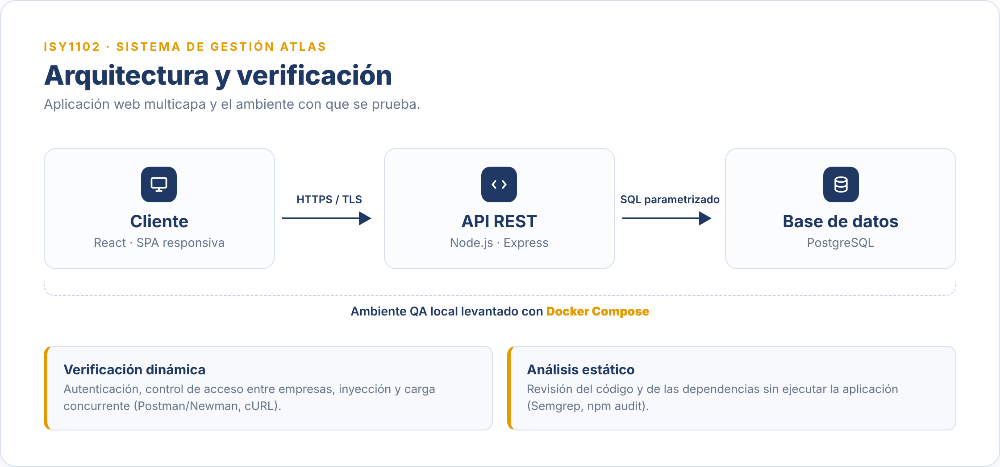

<p align="center">
  
</p>

<h1 align="center">Sistema de Gestión Atlas — Seguridad y Calidad</h1>

<p align="center">
  Plan de pruebas, ejecución y defensa del caso semestral de <b>ISY1102</b> (Duoc UC).<br>
  Atlas es la plataforma web de CreaLab SpA para que pymes gestionen clientes, contratos y documentos.
</p>

<p align="center">
  
</p>

## Las tres entregas

| Entrega | Qué contiene | Archivos |
|---|---|---|
| **EP1** | Plan de pruebas: criterios, estrategia, diseño de los 9 casos y trazabilidad | [`docs/EP1…informe`](docs/EP1_ISY1102_Informe_Forma_A_Grupo15.pdf) · [`anexos/`](anexos/) |
| **EP3** | Ejecución de los casos, hallazgos con su criticidad y análisis ético-normativo | [`docs/EP3…informe`](docs/EP3_ISY1102_Informe_Atlas_Grupo15.docx) |
| **EP4** | Defensa: presentación y guión | [`deck`](docs/EP4_ISY1102_Presentacion_Atlas_Grupo15.pdf) · [`guión`](docs/EP4_ISY1102_Guion_Defensa_Grupo15.docx) |

## Ejecución

Al momento de la evaluación Atlas no tenía un ambiente QA habilitado, así que se levantó uno local (`laboratorio/`) conforme a la ERS y a la colección de endpoints, y las pruebas se ejecutaron ahí.

```bash
cd laboratorio
./bootstrap.sh      # levanta API + PostgreSQL en Docker, sobre HTTPS
./pruebas.sh        # verificación dinámica: autenticación, control de acceso, inyección, carga
./sast.sh           # análisis estático: Semgrep (código) + npm audit (dependencias)
```

Resultado: 100 % de los casos ejecutados, 4 en pase y 2 en fallo.

| Hallazgo | Caso | Criticidad |
|---|---|---|
| IDOR entre empresas: lectura de RUT y cuenta bancaria de un tercero | CP-03 | **Crítico** |
| Stored XSS: descripción sin escapar y sin cabecera CSP | CP-06 | **Grave** |

El resto pasó: token seguro con vigencia de 15 minutos, rol editor bloqueado al escribir, validación 201/422 y 200 peticiones concurrentes sin caídas. El análisis estático no halló patrones peligrosos en el código y marcó cuatro dependencias vulnerables; el IDOR no aparece ahí, porque un control de acceso ausente es un fallo de lógica y no un patrón de código, lo que confirma el valor de la prueba dinámica.

## Estructura

```
docs/            informes (EP1, EP3) y defensa (EP4: presentación y guión)
anexos/          casos de prueba (planilla) y matriz de trazabilidad
laboratorio/     ambiente QA local: API, base de datos, Docker y scripts
pruebas/         suites del plan: api, e2e, rendimiento y usabilidad
assets/          recursos del README
```

## Grupo

**Grupo 15** — Elías Delgado Manríquez y Rolando Aldana
**Docente** — Johnnathan René Cubillos Flores
